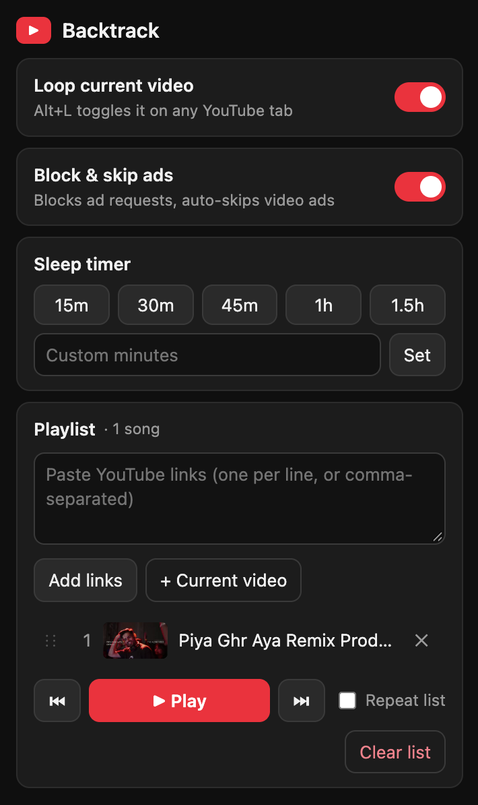
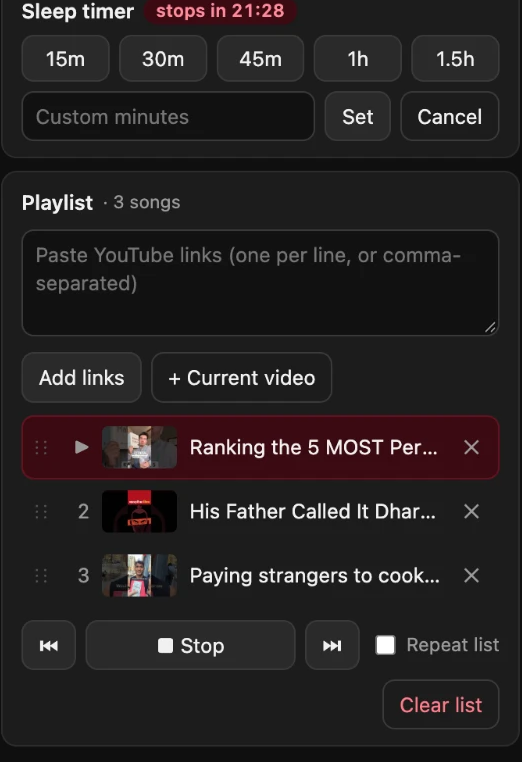

<h1 align="center">Backtrack</h1>

<p align="center"><strong>The YouTube features you always wanted: loop, your own playlist, a sleep timer, and no ads.</strong><br/>
A Chrome extension, with end-to-end tests that run against a fake YouTube.<br/>
<em>Coming soon to the Chrome Web Store.</em></p>

<p align="center">
  
  
  
  
</p>

<p align="center">
  
  &nbsp;&nbsp;
  
</p>

## Features

**Loop.** Repeat the current video forever. Toggle it from the popup or press <kbd>Alt</kbd> <kbd>L</kbd>; the toolbar icon shows ∞ while it's on.

**Your own playlist**
- Paste any YouTube link (watch, youtu.be, Shorts, embed, live, YouTube Music, or a bare video ID), or add the video you're watching.
- Titles and thumbnails load automatically. Drag to reorder, click a song to play from there.
- Play, stop, previous, next, and repeat the whole list.
- Songs switch without reloading the page, and the list keeps going while the tab is in the background.
- When the list ends, it stops. YouTube's autoplay doesn't hijack it with a random video.
- It answers YouTube's *"Continue watching?"* pop-up for you.

**Sleep timer.** 15m / 30m / 45m / 1h / 1.5h presets or any number of minutes, with a live countdown. When time is up it pauses the video and stops the playlist.

**Ad blocker** (on by default)
- Blocks Google ad servers and YouTube's ad and tracking requests with Chrome's built-in request blocking (`declarativeNetRequest`).
- If a video ad still plays, it's muted, sped up and skipped, then your volume and speed are restored.
- Hides ad slots on the home page, search results, sidebar and banners.

## Install

The Chrome Web Store listing is on the way. Until then:

1. Download or clone this repo.
2. Open `chrome://extensions` and turn on **Developer mode**.
3. Click **Load unpacked** and select this folder.

## Testing

YouTube's page changes constantly, so a regression suite matters more than usual here.

- **Unit tests** for link parsing and helper logic.
- **50+ Playwright end-to-end tests** that load the real extension into Chromium against a local fake YouTube page, covering loop, timer, playlist, popup and ad handling. They run offline, quickly and reliably in CI on every push.
- **A live smoke test** against real youtube.com, run on demand.

```bash
npm install && npx playwright install chromium
npm test            # unit + offline browser tests (fake YouTube)
npm run test:live   # smoke test on real youtube.com
```

[TESTING.md](TESTING.md) lists which tests to add with each kind of change.

## Notes

- The playlist runs inside one YouTube tab, so keep that tab open (it doesn't have to be active). Other YouTube tabs are left alone.
- YouTube changes its ad system often, so some ads may get through.

## Project layout

| File | What it does |
| --- | --- |
| `manifest.json` | Extension config, permissions, <kbd>Alt</kbd> <kbd>L</kbd> shortcut |
| `background.js` | Service worker: state, timer, toolbar badge |
| `content.js` / `page.js` | Runs on YouTube: controls the player, playlist and ad skipping |
| `rules.json` | Network rules that block ad requests |
| `popup.*` | The toolbar popup UI |
| `lib.js` | Shared helpers (link parsing, formatting) |
| `tests/` | Unit, offline end-to-end, and live tests |
